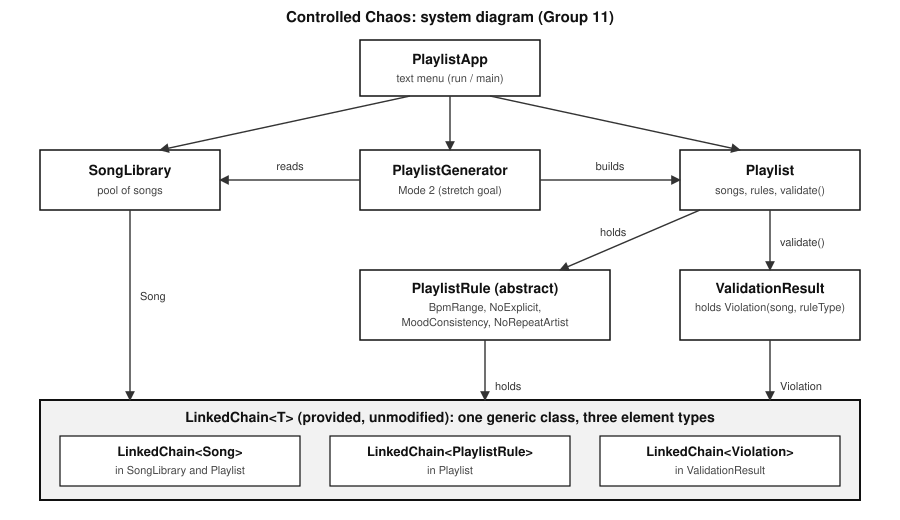

# Controlled Chaos: Smart Playlist Manager
## CS 2114 Project 2, Deliverable 4: Final Build

Group 11: Advay, Krishanth, Tyler

A text-menu program for building a playlist and checking it against rules (BPM range, no explicit songs, one mood, no artist twice in a row). It can also generate a playlist that satisfies the rules from a song library. Songs, rules, and violations are all stored in the provided `LinkedChain<T>`, unmodified.



## How to Compile and Run

All `.java` files are in one folder with `junit-4.13.2.jar` and `hamcrest-core-1.3.jar`. If the jars are missing:
```
curl -O https://repo1.maven.org/maven2/junit/junit/4.13.2/junit-4.13.2.jar
curl -O https://repo1.maven.org/maven2/org/hamcrest/hamcrest-core/1.3/hamcrest-core-1.3.jar
```
On Windows, use `;` instead of `:` between jar names.

**Compile**
```
javac -cp junit-4.13.2.jar:hamcrest-core-1.3.jar *.java
```

**Run the program** (interactive menu; option 14 loads 10 sample songs)
```
java PlaylistApp
```

**Run the scripted demo** (a fixed run of the MVP path plus 12 bad inputs)
```
java PlaylistDemo
```

**Run the tests.** Expected output: `OK (193 tests)`.
```
java -cp .:junit-4.13.2.jar:hamcrest-core-1.3.jar org.junit.runner.JUnitCore SongTest PlaylistTest PlaylistRuleTest ValidationResultTest SongLibraryTest PlaylistGeneratorTest PlaylistAppTest
```
They also run from an IDE as JUnit 4 tests. If JUnit reports "No runnable methods", delete the old `.class` files (`rm -f *.class`) and recompile.

## What It Does

| Menu | Feature |
|---|---|
| 1 to 3 | Add, remove, and list songs in the library |
| 4 to 6 | Add a library song to the playlist, remove it, list the playlist (`>` marks the current song) |
| 7 to 9 | Add, remove, and list rules. One rule per type. |
| 10 | Validate: PASS or FAIL for each rule, with the songs that broke it |
| 11, 12 | Next and previous song |
| 13 | Generate a playlist of a chosen length that satisfies the current rules (replaces the playlist) |
| 14 | Load 10 sample songs |

**Bad input is reported and never crashes the program.** Examples: a non-numeric, empty, or non-positive BPM re-prompts; a mood outside `[energetic, chill, focus, party]` re-prompts; empty BpmRange parameters print "All rule parameters required before adding"; a second rule of the same type is rejected; an unknown song id prints "Song not found in playlist"; next or previous at either end prints a message; an empty playlist prints "Playlist is empty"; an invalid menu choice prints the valid range.

## Where the LinkedChain Is Used

`LinkedChain.java` is the provided file. The app classes call only its public methods (`addToEnd`, `remove(T)`, `contains`, `get`, `size`, `isEmpty`, `toArray`), and no application logic lives in it. One class, three element types, no type-specific copies:

| Element type | Held in | Purpose |
|---|---|---|
| `Song` | `Playlist`, `SongLibrary` | Playlist order; the pool of songs |
| `PlaylistRule` | `Playlist` | Active rules (`BpmRange`, `NoExplicit`, `MoodConsistency`, `NoRepeatArtist`) |
| `ValidationResult.Violation` | `ValidationResult` | Which song broke which rule |

## Stretch Goal

**Mode 2 (reached): playlist generation.** `PlaylistGenerator.generate(library, rules, length)` removes songs that break a rule on their own, then shuffles and picks songs, retrying up to 1000 times when `NoRepeatArtist` blocks an ordering. It checks every result with `Playlist.validate()`. If it cannot build a playlist, it returns a `GenerationResult` naming the rules that could not be satisfied.

Dropped from the scope: live position suggestions, GUI, multiple playlists, collaborative playlists.

## Changes from the Deliverable 2 Spec and the Deliverable 3 Prototype

| Change | Why |
|---|---|
| `nextSong()`, `previousSong()`, `getCurrentSong()` built on the singly-linked `LinkedChain` with `currentIndex` and `get(i)`; O(n), not the spec's O(1). Out of range throws `NoSuchElementException`. | The provided chain has no `prev` pointer. We kept it unmodified rather than rewrite it. All 18 of the spec's bad-input cases are now handled. |
| `Playlist.removeSong` shifts `currentIndex` when a song at or before it is removed. | Otherwise the current song changes silently. Tested in `PlaylistTest`. |
| Added `removeRuleByType(String)`, `getSongs()`, `getRules()`. | The menu needs to remove a rule by type, and the identity-based `removeRule` cannot do that. `getSongs()` and `getRules()` return copies, so callers cannot touch the chains. |
| Added `toString()` to each rule class. | The menu prints rules, for example `BpmRange(90-150)`. |
| Added `SongLibrary`, `PlaylistGenerator`, `GenerationResult`. | Mode 2. |
| `PlaylistApp` is now the interactive menu. The old fixed script is `PlaylistDemo`. | D3 only ran a script; the final needs real input and re-prompting. |
| The menu enforces the scope's mood list and re-prompts. `Song` still accepts any mood. | Matches the scope; the class stays permissive for callers. |

Unchanged from D3: `NoRepeatArtist` is checked in `Playlist.validate()` (it needs the previous song); duplicate song ids are rejected (spec over scope); `getViolations()` returns an array.

## Big-O

n = songs, r = rules, v = violations.

| Method | Actual | Note |
|---|---|---|
| `Playlist.addSong` | O(n) | `contains()` scan plus `addToEnd()`; spec said O(1) |
| `Playlist.removeSong` | O(n) | index scan, then `remove(T)` |
| `Playlist.nextSong`, `previousSong`, `getCurrentSong` | O(n) | `get(i)` walks the chain; spec said O(1) |
| `Playlist.addRule`, `removeRule`, `removeRuleByType` | O(r) | |
| `Playlist.getSongs`, `getRules` | O(n), O(r) | copy |
| `Playlist.validate` | O(n·r + v²) | each violation costs O(v) via `addToEnd()` |
| `SongLibrary.addSong`, `removeSong`, `findById` | O(n) | |
| `PlaylistGenerator.generate` | O(attempts · (n + length²) + n·r) | `addSong` costs O(n) inside the loop; at most 1000 attempts |

## Known Limitations

- `removeRule(PlaylistRule)` matches by object identity (`PlaylistRule` has no `equals`). Use `removeRuleByType`.
- Removing a song from the library does not remove it from a playlist.
- Generation is random with retries. A feasible `NoRepeatArtist` ordering can be reported as impossible if 1000 shuffles miss it.
- Nothing is saved between runs.

## Attribution

| File | Team member(s) | How |
|---|---|---|
| `LinkedChain.java` | CS 2114 staff | Provided; unmodified |
| `Song.java` | Krishanth | First version GenAI-generated; revised (nullable mood) and reviewed |
| `PlaylistRule.java` | Advay | First version GenAI-generated; revised (null contract); `toString` added with GenAI; reviewed |
| `NoRepeatArtist.java` | Tyler | First version GenAI-generated; context dependency found while implementing |
| `BpmRange.java` | Advay | First version GenAI-generated; `toString` added with GenAI; reviewed |
| `NoExplicit.java` | Tyler | First version GenAI-generated; reviewed |
| `MoodConsistency.java` | Krishanth | First version GenAI-generated; revised (null-safe `validate`); `toString` added with GenAI |
| `ValidationResult.java` | Advay | First version GenAI-generated; revised (null checks on `Violation`) |
| `Playlist.java` | Advay | First version GenAI-generated; revised and reviewed; navigation, `removeRuleByType`, `getSongs`, `getRules` GenAI-generated for D4 and reviewed by [names] |
| `SongLibrary.java` | [names] | GenAI-generated for D4; reviewed and tested by [names] |
| `PlaylistGenerator.java` | [names] | GenAI-generated for D4; reviewed and tested by [names] |
| `GenerationResult.java` | [names] | GenAI-generated for D4; reviewed and tested by [names] |
| `PlaylistApp.java` | [names] | Interactive menu GenAI-generated for D4; reviewed and tested by [names] |
| `PlaylistDemo.java` | Krishanth | Scripted driver (was `PlaylistApp` in D3); renamed |
| `PlaylistTest.java` | Tyler, Advay | D3 tests; navigation, `removeRuleByType`, `getSongs`, `getRules` tests added for D4 (GenAI-generated, reviewed by [names]) |
| `SongTest.java` | Advay | Split from the original tests; getter, `equals`, `toString` cases |
| `PlaylistRuleTest.java` | Whole team | Split from the original tests; null-song cases; `toString` tests added for D4 |
| `ValidationResultTest.java` | Advay | Split from the original tests; empty, null, and `Violation` cases |
| `SongLibraryTest.java` | [names] | GenAI-generated for D4; run and reviewed by [names] |
| `PlaylistGeneratorTest.java` | [names] | GenAI-generated for D4; run and reviewed by [names] |
| `PlaylistAppTest.java` | [names] | GenAI-generated for D4 (scripted input); run and reviewed by [names] |
| `docs/system-diagram.svg` | [names] | Hand-written SVG drafted with GenAI; checked against the code by [names] |
| `README.md` | Tyler | Drafted with GenAI; checked against the code and rubric by [names] |

### How we used GenAI

We used Claude to generate the first version of every app class and the original tests from our Deliverable 2 spec and the provided `LinkedChain.java`, and again to generate the D4 code, tests, and diagram. The team ran, read, and edited the results.

- **Helped:** it noticed `LinkedChain` is singly-linked while our spec assumed doubly-linked; it suggested rejecting duplicate rules; it produced the edge-case tests (empty playlist, no rules, removing something not present, boundary BPM).
- **Did not work:** the first test file did not compile where it was generated; one generated test had a wrong expected violation count, which we found by running it; the first README draft listed work outside our scope, so we rewrote it from the scope and spec.
- **We verified:** by compiling and running all 193 tests, and by running `PlaylistApp` with bad input.
